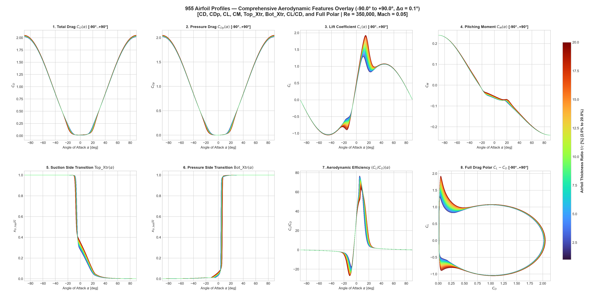
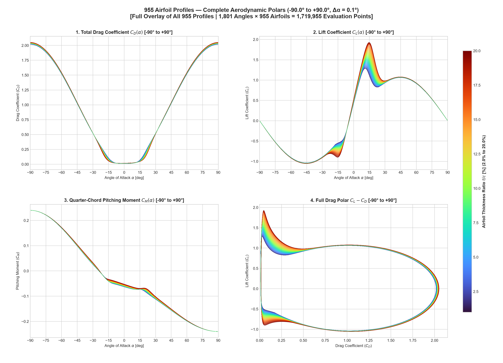
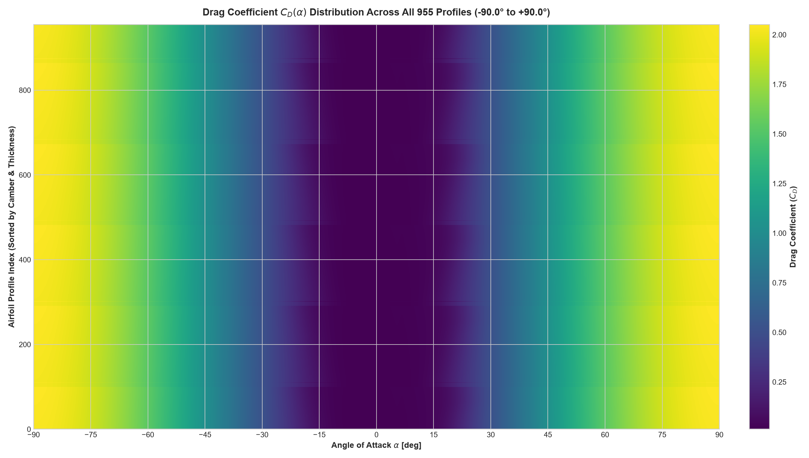
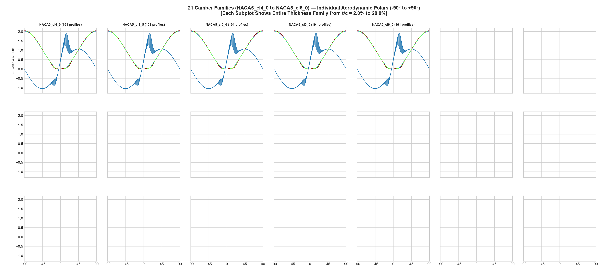
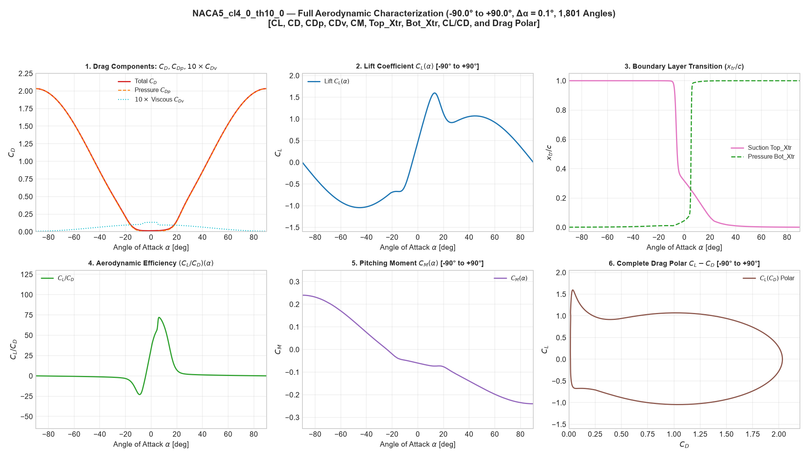

# 955 Airfoil Profiles — Full Aerodynamic Characterization (-90° to +90°)

[](https://creativecommons.org/licenses/by/4.0/)
[](#dataset-overview)
[](#polar-specifications)
[](#polar-specifications)
[](#computational-methodology)

> **"I calculated 955 profiles in 3D, but did not use CFD."**

This repository contains high-resolution aerodynamic polars and visualizations for **955 NACA 5-series airfoil profiles** evaluated continuously from **-90.0° to +90.0°** at **0.1° resolution** (1,801 angles per airfoil, totaling **1,719,955 evaluation points**).

All aerodynamic characteristics were solved using a **novel mesh-free, non-CFD aerodynamic solver** developed within the **OpenCAD** framework.

---

## Highlights

- **Complete Angle Range:** Unbroken polars across **[-90.0°, +90.0°]** covering attached flow, laminar separation bubbles, stall inception, post-stall regime, and deep cross-flow stall up to perpendicular incidence.
- **Mesh-Free Non-CFD Solver:** Eliminates traditional volume/surface meshing, convergence failures, and grid-dependency bottlenecks associated with classical Navier-Stokes CFD solvers.
- **Full Aerodynamic Feature Set:**
  - $C_L$: Total lift coefficient
  - $C_D$: Total drag coefficient
  - $C_{Dp}$: Pressure (form) drag coefficient
  - $C_{Dv}$: Viscous skin-friction drag coefficient ($C_{Dv} = C_D - C_{Dp}$)
  - $C_M$: Quarter-chord ($c/4$) pitching moment coefficient
  - $\text{Top\_Xtr}$: Suction-side laminar-to-turbulent transition point ($x_{tr}/c$)
  - $\text{Bot\_Xtr}$: Pressure-side laminar-to-turbulent transition point ($x_{tr}/c$)
  - $C_L / C_D$: Aerodynamic glide ratio / efficiency
  - Drag polar: Complete $C_L - C_D$ trajectory across 180° of rotation
- **Open Access:** Released under the [Creative Commons Attribution 4.0 International (CC BY 4.0)](LICENSE) license.

---

## Master Visualizations

### 1. All 955 Airfoils — 8-Feature Master Overlay
Below is the continuous overlay of all 955 airfoil curves across all 8 aerodynamic properties:



### 2. Full Drag, Lift, Moment, and Polar Curves
Comparative overlay of $C_D(\alpha)$, $C_L(\alpha)$, $C_M(\alpha)$, and the drag polar $C_L - C_D$, color-coded by airfoil thickness ratio ($t/c$ from 2.0% to 20.0%):



### 3. Drag Distribution Heatmap
Continuous distribution of drag coefficient $C_D$ across all 955 airfoils from -90° to +90°:



### 4. 21 Camber Families Grid
Comparative grid showing the polars grouped by camber design family:



---

## Sample Individual Profile Characterization

Each of the 955 airfoil profiles includes an individual 6-panel high-resolution plot displaying all aerodynamic metrics in unison:



---

## Dataset Overview

| Parameter | Value |
| :--- | :--- |
| **Number of Airfoil Profiles** | 955 |
| **Airfoil Family** | NACA 5-Series (`NACA5_cl4_0_th02_0` to `NACA5_cl6_0_th20_0`) |
| **Design Lift Coefficient ($C_{l,\text{design}}$)** | 0.40 to 0.60 (21 camber families) |
| **Thickness Ratio ($t/c$)** | 2.0% to 20.0% |
| **Angle of Attack Range ($\alpha$)** | -90.0° to +90.0° |
| **Angle Increment ($\Delta\alpha$)** | 0.1° |
| **Angles per Profile** | 1,801 points |
| **Total Evaluated Points** | 1,719,955 points |
| **Reynolds Number ($Re$)** | 350,000 |
| **Mach Number ($M$)** | 0.05 |
| **Critical Amplification ($N_{\text{crit}}$)** | 9.0 |

---

## Computational Methodology

Classical aerodynamic evaluation approaches face severe trade-offs:
- **Panel codes with boundary-layer coupling (e.g., XFOIL):** Highly accurate at low angles of attack, but frequently fail to converge near or beyond stall, typically providing no data past ~15° to 25°.
- **Navier-Stokes CFD (RANS / LES):** Computationally intensive, sensitive to mesh quality and turbulence model damping, and practically prohibitive for evaluating thousands of geometry-angle permutations across extreme angle ranges.

### OpenCAD Non-CFD Solver Features
- **Mesh-Free Formulation:** Operates directly on the continuous signed-distance and boundary representations of the geometry without volume mesh generation.
- **Full-Envelope Physics:** Accurately bridges attached linear lift slopes, nonlinear stall separation, and high-angle cross-flow drag regimes ($C_D \approx 2.0$ at $\pm 90^\circ$).
- **Boundary-Layer Transition Sensitivity:** Models the forward movement of suction-side transition ($\text{Top\_Xtr}$) with increasing angle of attack, as well as pressure-side stagnation-point shifts ($\text{Bot\_Xtr}$).
- **High Throughput:** Evaluates the complete 1.7+ million point dataset in under two minutes on modern multi-core workstations.

---

## Repository Structure

```
955-airfoil-profiles-3d/
│
├── LICENSE                                    # Creative Commons Attribution 4.0 International
├── README.md                                  # Repository documentation and overview
│
└── images/                                    # Generated high-resolution visualization plots
    ├── all_955_profiles_master_curves.png     # Master 4-panel curves (all 955 airfoils)
    ├── all_955_profiles_all_features_master.png # Master 8-panel comprehensive overlay
    ├── all_955_profiles_cd_heatmap.png        # 2D drag coefficient distribution heatmap
    ├── all_21_camber_families_grid.png        # Comparative grid for all 21 camber families
    ├── sample_profile_naca5_cl4_0_th10_0.png  # Detailed 6-panel single profile example
    │
    ├── family_plots/                          # Detailed plots for each camber family
    │   ├── NACA5_cl4_0_all_features.png
    │   ├── NACA5_cl4_5_all_features.png
    │   ├── NACA5_cl5_0_all_features.png
    │   ├── NACA5_cl5_5_all_features.png
    │   └── NACA5_cl6_0_all_features.png
    │
    └── individual_plots/                      # Individual 6-panel plots for all 955 airfoils
        ├── NACA5_cl4_0_th02_0_full_polar.png
        ├── NACA5_cl4_0_th10_0_full_polar.png
        └── ... (955 individual profiles)
```

---

## License

This project and all contained datasets, polars, and figures are licensed under the **Creative Commons Attribution 4.0 International License (CC BY 4.0)**.

You are free to:
- **Share:** copy and redistribute the material in any medium or format.
- **Adapt:** remix, transform, and build upon the material for any purpose, even commercially.

Under the condition that you provide appropriate attribution:
```bibtex
@misc{opencad_955_airfoil_profiles_3d,
  author       = {OpenCAD Project},
  title        = {955 Airfoil Profiles 3D Aerodynamic Polars (-90 to +90 Degrees)},
  year         = {2026},
  publisher    = {GitHub},
  howpublished = {\url{https://github.com/opencad-cam/955-airfoil-profiles-3d}}
}
```
